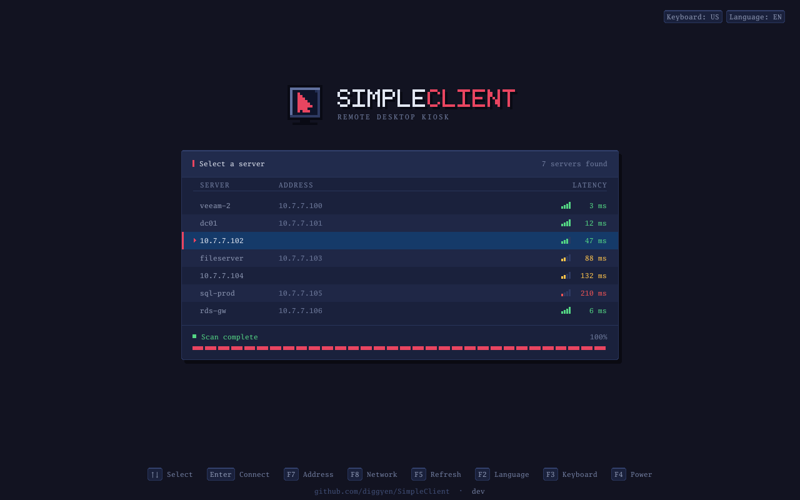
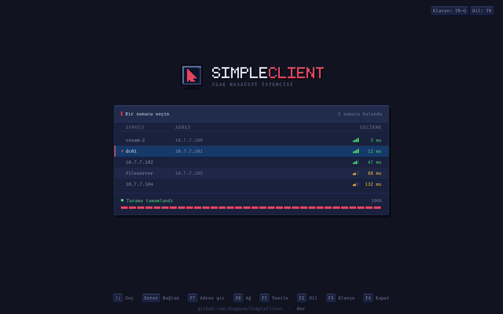

# SimpleClient

A bootable remote-desktop kiosk. Boot it on a machine, it scans the local
network for RDP hosts, you pick one, and it connects — full screen, no desktop
environment underneath.



It draws straight to the Linux framebuffer (`/dev/fb0`) and reads raw evdev
input. There is no X11 and no Wayland: the whole system is a kernel, busybox and
one static Go binary in an initramfs, about 40 MB of ISO. Every pixel above —
the mark, the lettering, the signal bars — is drawn by the binary itself; there
is no toolkit and no image asset in the ISO.

The UI ships in **English** (default) and **Türkçe**. Pick one from the boot
menu, or press **F2** at any time to switch.



Every screen is in [`docs/screenshots/`](docs/screenshots), including the
credential dialog, the empty and error states, and a capture of the real thing
booting under QEMU.

## Get it

Download `simpleclient.iso` from the
[latest release](https://github.com/diggyen/SimpleClient/releases/latest) and
write it to a USB stick:

```sh
# Linux
sudo dd if=simpleclient.iso of=/dev/sdX bs=4M status=progress conv=fsync

# macOS  (diskutil list to find the number; use rdiskN, not diskN)
diskutil unmountDisk /dev/diskN
sudo dd if=simpleclient.iso of=/dev/rdiskN bs=4m
sync
```

Verify it first if you like: `shasum -a 256 -c SHA256SUMS`.

Boots on UEFI and legacy BIOS machines, with Secure Boot on or off: the boot
chain is the one Debian's own install media use — shim signed by Microsoft,
GRUB and the kernel signed by Debian. If it does not boot, [TROUBLESHOOTING.md](docs/TROUBLESHOOTING.md#the-usb-stick-does-not-boot)
walks through the causes in order of likelihood.

## Use it

| Key | Action |
| --- | --- |
| `↑` `↓` `PgUp` `PgDn` | Move through the host list |
| `Enter` | Open the credential dialog for the selected host |
| `Tab` | Move between username / password / domain / buttons |
| `Esc` | Close the dialog |
| `F5` | Rescan the network |
| `F2` | Switch language (English ⇄ Türkçe), and the keyboard layout with it |
| `F3` | Switch keyboard layout on its own (US ⇄ TR-Q ⇄ TR-F) |
| `F4` | Move sound to the next output: speakers or headphones, the monitor, a USB headset |
| `F6` | In the credential dialog: show or hide the domain field |
| `F7` | Connect to a server by address (`10.0.0.5`, `rdp.example.com:53389`) |
| `F8` | Network settings: DHCP or a fixed address, and the wireless network |
| `F9` | Install to the machine's disk (when started from a USB stick or CD) |
| `F10` | In the credential dialog: what the kiosk does at startup — the server list, this server's dialog, or logging on to it |
| `Ctrl`+`Alt`+`End` | Disconnect from an active session |

The scan probes TCP port 3389 across the subnet the machine got from DHCP. If
there is no DHCP server it falls back to a link-local address and scans that.
Each host is listed with the round trip of that handshake, graded onto four
signal bars, so a link too slow to work as a desktop session is visible before
you connect to it rather than after.

The two caps in the top-right corner show the active keyboard layout and
language. Choosing Türkçe — from the boot menu or with `F2` — selects the
Turkish Q layout with it; `F3` overrides that if your keyboard says otherwise.
The layout applies to the credential dialog only: inside a session the raw
keycode is forwarded and the remote machine applies its own.

Once a host has been connected to, its username and domain are filled in the
next time you open its dialog, with the cursor in the password field. A kiosk
running from a USB stick or CD keeps that in RAM until it is switched off; an
installed one keeps it on its disk, with the servers it has connected to. The
password is not kept, unless F10 asks for it.

`F10` in the dialog makes that server the one the kiosk starts at. Either its
dialog opens at power-on with the account filled in, or — with the password
kept — the kiosk logs on by itself after a five-second countdown, which `Esc`
leaves for the server list. Either way it goes back there when the session
ends, and keeps trying a server that is not up yet. The choice is saved once a
connection made with it works, where the network settings are: on the disk of
an installed kiosk, on the USB stick of a live one. A kept password is encoded
there, not encrypted — whoever has the disk or the stick can read it — so keep
it for an account set up for a kiosk.

The scan covers **the kiosk's own subnet only**. A server anywhere else is
reached with `F7`, by address or name; once connected to, it stays in the list.

On a machine with a wireless card — built in or a USB stick — the network
settings have a *Wireless* row, which lists the networks in range, strongest
first. Choosing one asks for what it takes: its password; a user name and
password on an enterprise network (WPA2/WPA3-Enterprise with PEAP, as Windows
domains run it); nothing on an open one. A hidden network is joined by name
from the last row. The network is kept once the kiosk is on it, where the
network settings are, and joined at every boot; a password the network refuses
leaves the kiosk on the network it had. `Del` forgets it. What is kept is the
key the password makes — the NT hash on an enterprise network — and not the
password itself, except on a WPA3-only network, whose handshake needs it.

## USB devices

What is plugged into the kiosk goes to the server the session is with — only
that one, and only while the session lasts:

- **Drives** — USB sticks, USB disks, SD cards (FAT, exFAT, NTFS, ext4) — appear
  on the server as a drive under their own name: in *This PC* on Windows, in
  `~/thinclient_drives` on Linux. A stick can be pulled out at any time;
  what the server saved is on it within a second.
- **Everything else** — printers, scanners, webcams, smart-card readers and
  tokens (e-İmza, ID cards), USB-serial console cables, other devices — goes to
  the server whole, as if plugged into it, and works there with the server's
  own drivers. A Windows server gets them through RDP's USB redirection,
  smart-card readers through its smart-card redirection. A Linux server gets
  them over USB/IP when it runs SimpleClient's agent, which the server script
  below installs.
- **Keyboards, mice, touch screens, headsets, hubs and network adapters** stay
  with the kiosk, which uses them. A webcam's microphone goes with the webcam,
  for the video call it is part of.

## Linux servers

Windows serves the kiosk as it is. A Linux desktop needs xrdp, and the one
distributions package (0.9 on Ubuntu 24.04 and Linux Mint 22) has no graphics
pipeline: the screen goes as bitmaps, tile by tile. One script, run once on the
server, builds xrdp 0.10 and sets it up for the kiosks — RemoteFX at up to 120
fps, which encodes only what changed (a window dragged across a 1920x1080
kiosk moves at over 100 fps, with xrdp at a fifth of a core), H.264 for links
slower than a LAN (`--h264`), sound both ways through PipeWire or PulseAudio,
the Turkish keyboards
(which xrdp does not map), the machine's own desktop for every user, no polkit
prompts, the kiosks' USB devices over USB/IP (agent on port 3241; the kernel
needs `vhci-hcd`, which the script installs where it is packaged separately),
ports 3389 and 3241 open:

```sh
curl -fsSLO https://raw.githubusercontent.com/diggyen/SimpleClient/iyilestirme/server/simpleclient-server.sh
sudo bash simpleclient-server.sh
```

Tested on Ubuntu 26.04, 24.04 and 22.04 (Linux Mint 22 and 21 are built on
the last two, its next release on the first) and Fedora 42, with Xfce and KDE
Plasma 5.27 and 6.6; Debian, openSUSE and Arch are attempted. Fedora's own
repositories have no x264, so there it builds with Cisco's OpenH264, which
encodes about a quarter fewer frames (55 fps against 75 on the same machine);
with RPM Fusion enabled it takes x264. Run it again after a distribution
upgrade.
`--session NAME` picks the desktop when there are several (`mate`, `xfce`,
`cinnamon`, `plasmax11`, ...); MATE and Xfce are installed when asked for.
Cinnamon, Linux Mint's own, cannot run without its compositor, which a remote
session — no GPU there — draws in software: dragging a 1280x800 window across
a 1920x1080 kiosk took 2.9 cores of a 4-vCPU VM and made 32 fps. So remote
sessions of a Cinnamon machine get MATE (installed if need be), with MATE's own
compositor off: the same window moves at over 100 fps on 0.9 core, and at 80
on a 3440x1440 kiosk. The console keeps Cinnamon; `--session cinnamon` keeps it
for remote sessions too. A desktop that runs only on Wayland cannot be served
by xrdp. KDE Plasma 6 keeps its X11 session in a package of its own, which
Kubuntu (25.10 and later) and Fedora leave out of a fresh install; the script
adds it, and turns KDE's compositor off in remote sessions, which have no GPU
for it. Plasma 6.8 and later have none (Arch, openSUSE Tumbleweed), nor does
the newest GNOME: remote sessions there need a second desktop, such as Xfce.

## Build it

Needs Docker. The kernel, initramfs and ISO are produced inside the build
container, so the result is the same on macOS, Linux and CI.

```sh
make -f build/Makefile iso     # -> dist/simpleclient.iso
make -f build/Makefile binary  # -> dist/simpleclient (static, linux/amd64)
make -f build/Makefile test
```

You do not need spare hardware to try it — QEMU boots the same image that goes
on the stick:

```sh
bash build/test-qemu.sh                  # opens a window
bash build/test-qemu.sh --fake-rdp       # plus a host that appears in the list
```

[DEVELOPMENT.md](docs/DEVELOPMENT.md) covers the rest: iterating on the UI
without booting anything, the four boot combinations to run before trusting an
image, testing against a real RDP server, and cutting a release.

## Documentation

- **[ARCHITECTURE.md](docs/ARCHITECTURE.md)** — how the image boots, how the UI
  is drawn, how devices are found, and the decisions behind each
- **[DEVELOPMENT.md](docs/DEVELOPMENT.md)** — building, testing, releasing
- **[TROUBLESHOOTING.md](docs/TROUBLESHOOTING.md)** — symptom to diagnosis, and
  how to read the serial console

## Known limitations

Design boundaries, not bugs waiting to be filed:

- **The session takes each display's own resolution**, at its highest refresh
  rate (a 4K screen that manages only 30 Hz at 4K gets its largest 60 Hz mode);
  there is no setting for it. Up to four displays make one desktop, side by
  side in the order the graphics card lists them, the first the primary — the
  server's taskbar goes there. The order cannot be changed yet, and a display
  plugged in during a session joins at the next one.
- **No clipboard redirection.**
- **A smart-card reader on a Linux server is the whole server's.** Every remote
  session there can reach the readers pcscd has; the card's PIN still guards it.

## Repository layout

```
cmd/simpleclient/     entry point: opens the framebuffer, wires everything up
internal/ui/          render loop, screens, layout, the 8-bit mark and face
internal/scanner/     concurrent TCP scan of the subnet for port 3389
internal/rdp/         RDP client wrapper around tomatome/grdp
internal/framebuffer/ mmap'd /dev/fb0
internal/inputdev/    evdev keyboard and mouse reader
internal/i18n/        message catalogue (en, tr)
build/                Dockerfile, init, GRUB config, Makefile, vendor patches
docs/                 architecture, development, troubleshooting, screenshots
```

`vendor/` is committed on purpose: `tomatome/grdp` does not compile for Linux as
published, and three local patches in `build/patches/` fix it. CI fails if they
go missing. See [ARCHITECTURE.md](docs/ARCHITECTURE.md#rdp).

## Requirements

- x86-64 machine, UEFI or BIOS, Secure Boot on or off
- 512 MB RAM
- A wired NIC, or a wireless card or USB stick (Intel, Realtek, MediaTek,
  Qualcomm Atheros, Broadcom, Marvell, Ralink), with a driver in Debian's kernel
- Somewhere on the same subnet actually listening on 3389
